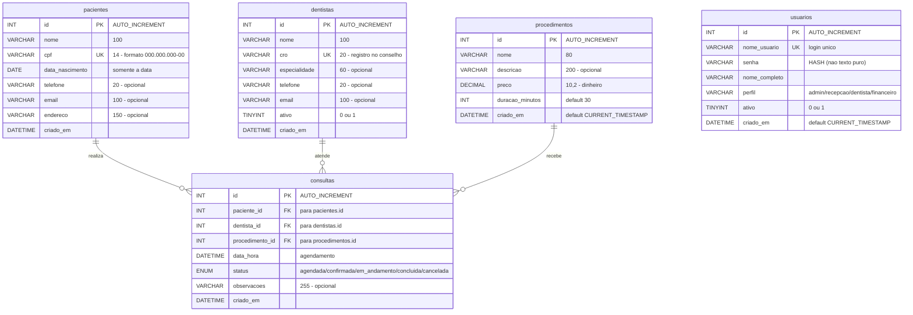

# Modelo Entidade-Relacionamento — Clínica Odontológica

**Banco:** `clinica_odontologica` · **5 tabelas** (limite máximo da atividade)

## Diagrama

> A tabela `usuarios` não se relaciona com as demais: ela guarda apenas
> quem pode acessar o sistema (exigência da atividade: "cadastro de
> usuários, armazenando o usuário e senha").

## Relacionamentos em detalhe

| Relacionamento | Cardinalidade | Chave | Regra |
|---|---|---|---|
| pacientes → consultas | 1 : N | `consultas.paciente_id` | `ON DELETE RESTRICT` (não apaga paciente com consulta) |
| dentistas → consultas | 1 : N | `consultas.dentista_id` | `ON DELETE RESTRICT` |
| procedimentos → consultas | 1 : N | `consultas.procedimento_id` | `ON DELETE RESTRICT` |

Todos usam `ON UPDATE CASCADE` (se o id mudar, acompanha) e
`ON DELETE RESTRICT` (proteção contra exclusão em cascata acidental).

## Decisões de modelagem

- **Por que a tabela `consultas`?** Ela materializa o relacionamento
  N:N entre paciente e dentista (um paciente atende vários dentistas;
  um dentista atende vários pacientes) e ainda guarda o procedimento.
  Sem ela, seria preciso duplicar dados nas duas pontas.
- **Por que separar `procedimentos` de `consultas`?** Evita repetir
  nome, preço e duração a cada agendamento: o preço muda no catálogo
  e não retroage para consultas antigas (histórico fiel).
- **`DECIMAL(10,2)` e não `FLOAT` para preço:** ponto flutuante perde
  precisão em dinheiro (0,1 + 0,2 ≠ 0,3 em binário).
- **`DATE` para nascimento e `DATETIME` para agendamento:** cada
  campo guarda só o que precisa, e o MySQL passa a validar o formato.
- **`ENUM` para status:** o banco recusa valores fora da lista, mesmo
  que alguém tente gravar direto por SQL.
- **`UNIQUE` em `nome_usuario`, `cpf` e `cro`:** unicidade garantida
  pelo banco, não só pela aplicação (protege contra dois cadastros
  simultâneos do mesmo CPF).
- **`INDEX idx_consulta_data`:** acelera as busças por data, que é o
  filtro mais usado do sistema.
- **Senha como hash:** a atividade pede "armazenar usuário e senha",
  mas guardar a senha em texto puro seria uma falha grave; guardamos o
  hash gerado pelo Werkzeug (mesma técnica do Flask).
