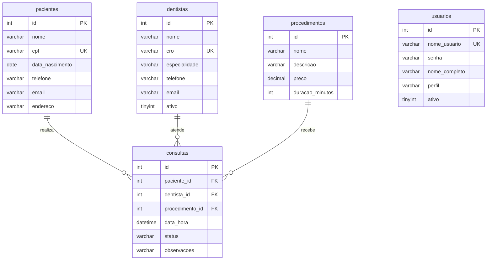

# ETAPA 1 — PLANO DE EXECUÇÃO

**Projeto:** Sistema Web para Clínica Odontológica
**Disciplina:** Aplicação WEB integrada com Banco de Dados
**Responsável pela etapa:** Back-end (API + Banco de Dados) **e Front-end**
**Data da apresentação:** 19/11/2026
**Tema sorteado:** Clínica Odontológica

> **Atualização:** como o colega de dupla não pôde entregar o Front-end,
> a interface também foi construída e integrada ao Back-end.
> O contrato previsto neste plano (API REST em JSON) foi mantido e é
> exatamente o que o Front-end consome. Detalhes da interface em
> [05-guia-do-front-end.md](05-guia-do-front-end.md).

---

## 1. Contexto e objetivo

O problema real: uma clínica odontológica precisa controlar seus **pacientes**, seus
**dentistas**, os **procedimentos** oferecidos e o **agendamento de consultas**, além de
permitir que os funcionários acessem o sistema com **usuário e senha**.

O objetivo desta etapa é entregar um **Back-end pronto e testado** que:

1. Armazene os dados efetivamente no **MySQL** (regra obrigatória da atividade);
2. Exponha uma **API REST em JSON** com todas as operações **CRUD**;
3. Seja **fácil de integrar** com o Front-end (HTML/CSS/Bootstrap), que será feito
   por outra pessoa.

> **Decisão de escopo (acordada com a dupla):** a comunicação Back ↔ Front será feita
> por **API REST retornando JSON**. Assim, quem faz o Front-end trabalha de forma
> independente, sem precisar mexer no código Python, e pode até testar a API antes de
> existir qualquer tela.

---

## 2. O que entra e o que fica para o Front-end

| Entra nesta etapa (Back-end) | Fica para a etapa do Front-end |
|---|---|
| Banco de dados MySQL (5 tabelas) | ~~Tela inicial / painel principal~~ → entregue em `front-end/` |
| Script SQL (CREATE DATABASE, CREATE TABLE, INSERT) | ~~Menu de navegação~~ → entregue em `front-end/` |
| API REST (todas as rotas CRUD) | ~~Formulários de cadastro/edição~~ → entregue em `front-end/` |
| Validação e tratamento de erros | ~~Listagens, pesquisa e botões de exclusão~~ → entregue em `front-end/` |
| Usuário e senha (com senha criptografada) | ~~Layout, cores, Bootstrap, imagens~~ → entregue em `front-end/` |
| Testes automatizados da API | ~~Chamadas `fetch()` para a API~~ → entregue em `front-end/` |
| Documentação de integração | ~~Demonstração visual na apresentação~~ → entregue |

---

## 3. Modelo de dados (5 tabelas — limite máximo permitido)

**Banco:** `clinica_odontologica`

Foram usadas as **5 tabelas máximas** permitidas, cobrindo todos os cadastros
necessários + o obrigatório cadastro de usuários:

| # | Tabela | O que representa | Por que existe |
|---|---|---|---|
| 1 | `usuarios` | Usuários do sistema (usuário + senha) | **Obrigatório** em toda a atividade |
| 2 | `pacientes` | Pacientes da clínica | Cadastro principal do negócio |
| 3 | `dentistas` | Profissionais (com CRO) | Cadastro principal do negócio |
| 4 | `procedimentos` | Catálogo de serviços (limpeza, canal...) | Permite reutilizar o mesmo procedimento em várias consultas |
| 5 | `consultas` | Agendamentos | **Tabela de ligação** entre paciente, dentista e procedimento |

### 3.1 Relacionamentos (DER)



### 3.2 Regras do modelo

- **Chave primária** (`INT AUTO_INCREMENT`) em todas as tabelas;
- **Chaves estrangeiras** em `consultas` (3 FKs) com `ON DELETE RESTRICT` /
  `ON UPDATE CASCADE` — não é possível apagar um paciente que tem consultas;
- **Tipos de dados adequados**: `DATE` para nascimento, `DATETIME` para agendamento,
  `DECIMAL(10,2)` para preço (nunca `FLOAT` — erro clássico de monetário),
  `VARCHAR` com tamanhos realistas, `TINYINT(1)` para flags;
- **Unicidade** garantida por `UNIQUE` em `nome_usuario`, `cpf` e `cro`;
- **Senhas armazenadas como hash** (nunca em texto puro) — a atividade pede apenas
  "armazenar usuário e senha", mas guardar texto puro seria uma péssima prática;
- **Pelo menos 5 registros** em cada tabela (dados de teste inseridos via `INSERT INTO`).

---

## 4. Arquitetura da solução

```
[ Front-end: HTML + CSS + Bootstrap ]  ← outra pessoa
                 │  HTTP (JSON)
                 ▼
┌──────────────────────────────────────────────┐
│  Flask (Python) — API REST                  │
│  ┌────────────────────────────────────────┐  │
│  │ Rotas (Blueprints)  /api/pacientes ... │  │  ← valida entrada, monta JSON
│  ├────────────────────────────────────────┤  │
│  │ Banco (pool de conexões + SQL puro)    │  │  ← SELECT/INSERT/UPDATE/DELETE/JOIN
│  └────────────────────────────────────────┘  │
└──────────────────────────────────────────────┘
                 │  SQL (mysql-connector-python)
                 ▼
        MySQL 8 — banco clinica_odontologica
```

**Por que SQL puro (sem ORM)?**
A atividade exige *demonstrar* o uso de `CREATE TABLE`, `INSERT INTO`, `SELECT`,
`UPDATE`, `DELETE` e `JOIN`. Com SQL explícito no código, os comandos ficam visíveis
e fáceis de explicar na apresentação — e é exatamente o que o professor quer ver.

**Por que API REST?**
Padrão simples e uniforme: cada entidade vira um recurso com os 4 verbos HTTP do CRUD
(`GET` = ler, `POST` = criar, `PUT` = atualizar, `DELETE` = excluir). Quem faz o
Front-end só precisa seguir a tabela de endpoints (ver `03-guia-integracao-front-end.md`).

---

## 5. Contrato da API (resumo — detalhamento no guia 03)

| Recurso | Listar | Buscar | Criar | Editar | Excluir |
|---|---|---|---|---|---|
| Pacientes | `GET /api/pacientes` | `GET /api/pacientes/<id>` | `POST` | `PUT /<id>` | `DELETE /<id>` |
| Dentistas | `GET /api/dentistas` | `GET /api/dentistas/<id>` | `POST` | `PUT /<id>` | `DELETE /<id>` |
| Procedimentos | `GET /api/procedimentos` | `GET /api/procedimentos/<id>` | `POST` | `PUT /<id>` | `DELETE /<id>` |
| Consultas | `GET /api/consultas` | `GET /api/consultas/<id>` | `POST` | `PUT /<id>` | `DELETE /<id>` |
| Usuários | `GET /api/usuarios` | `GET /api/usuarios/<id>` | `POST` | `PUT /<id>` | `DELETE /<id>` |
| Login | — | — | `POST /api/auth/login` | — | — |
| Painel | `GET /api/painel/resumo` | — | — | — | — |

- `GET /api/consultas` já retorna os dados **juntados (JOIN)** com nome do paciente,
  nome do dentista e procedimento — pronto para a tabela do Front-end exibir;
- Pesquisa: `GET /api/pacientes?busca=maria` filtra por nome/cpf;
- Formato de resposta padronizado: `{"total": n, "dados": [...]}`;
- Formato de erro padronizado: `{"erro": "mensagem"}` + código HTTP adequado.

---

## 6. Estrutura de pastas e arquivos

```
clinica-odontologica/
├── run.py                       # ponto de entrada (sobe o Flask)
├── iniciar.bat                  # iniciar com um duplo clique (usa a venv)
├── requirements.txt             # dependências do Python
├── .env                         # configuração do banco (não editar sem necessidade)
├── database/
│   ├── 01_criar_banco_e_tabelas.sql   # CREATE DATABASE + CREATE TABLEs
│   ├── 02_dados_de_teste.sql          # INSERTs (5+ por tabela)
│   └── DER.md                         # diagrama entidade-relacionamento
├── app/
│   ├── __init__.py              # cria a aplicação Flask (app factory)
│   ├── config.py                # lê o .env
│   ├── banco.py                 # pool de conexões + funções de consulta
│   ├── validacao.py             # regras de validação dos dados recebidos
│   ├── erros.py                 # respostas de erro padronizadas
│   └── rotas/                   # um arquivo por recurso (Blueprints)
│       ├── auth.py              # login
│       ├── usuarios.py
│       ├── pacientes.py
│       ├── dentistas.py
│       ├── procedimentos.py
│       ├── consultas.py         # usa JOIN
│       └── painel.py            # resumo do painel (contagens)
├── testes/
│   └── testar_api.py            # testa o CRUD inteiro de ponta a ponta
├── docs/
│   ├── 01-plano-de-execucao.md      # este arquivo
│   ├── 02-passo-a-passo.md          # passo a passo de execução
│   ├── 03-guia-integracao-front-end.md
│   └── 04-relatorio.md
└── venv/                        # ambiente virtual Python (já criado)
```

---

## 7. Stack tecnológica

| Camada | Tecnologia | Motivo |
|---|---|---|
| Back-end | Python 3.14 + Flask 3.1 | Sugerido na atividade; leve e simples |
| Banco | MySQL 8.4 (instalado via winget) | Exigido pelas regras da atividade |
| Conexão | mysql-connector-python | Driver oficial da Oracle |
| CORS | flask-cors | Permite que o Front-end rodando em outra porta acesse a API |
| Config | python-dotenv | Guarda usuário/senha do banco fora do código |
| Front-end (futuro) | HTML, CSS, Bootstrap, Jinja2 | Sugeridos na atividade |

---

## 8. Plano de tarefas

| # | Etapa | Como será feito | Critério de conclusão |
|---|---|---|---|
| 1 | Instalar e configurar MySQL | `winget install Oracle.MySQL` + criar usuário da aplicação | Serviço rodando e login OK |
| 2 | Criar banco e tabelas | `database/01_criar_banco_e_tabelas.sql` | 5 tabelas criadas com PK/FK |
| 3 | Inserir dados de teste | `database/02_dados_de_teste.sql` | ≥5 registros por tabela |
| 4 | Montar a base do Flask | `run.py`, `app/__init__.py`, `config.py`, `banco.py` | `GET /api/painel/resumo` respondendo |
| 5 | Implementar CRUD de Pacientes | rota `app/rotas/pacientes.py` | GET/POST/PUT/DELETE funcionando |
| 6 | Implementar CRUD de Dentistas | rota `app/rotas/dentistas.py` | CRUD funcionando |
| 7 | Implementar CRUD de Procedimentos | rota `app/rotas/procedimentos.py` | CRUD funcionando |
| 8 | Implementar CRUD de Consultas (com JOIN) | rota `app/rotas/consultas.py` | Listagem já traz nomes das 3 tabelas |
| 9 | Implementar Usuários + Login | rotas `usuarios.py` e `auth.py` | Senha gravada em hash; login valida |
| 10 | Painel / resumo | rota `app/rotas/painel.py` | Contagens para a tela inicial |
| 11 | Validação e erros | `validacao.py`, `erros.py` | Mensagens claras + códigos HTTP corretos |
| 12 | Testes de ponta a ponta | `testes/testar_api.py` | Todos os testes aprovados |
| 13 | Guia de integração | `docs/03-guia-integracao-front-end.md` | Front-end consegue integrar sozinho |
| 14 | Relatório final | `docs/04-relatorio.md` | Explica o que, como e por quê |

---

## 9. Critérios de aceite (checklist da atividade)

| Requisito do PDF | Situação esperada |
|---|---|
| Banco com nome relacionado à empresa | `clinica_odontologica` |
| 3 a 5 tabelas | ✅ 5 tabelas |
| PRIMARY KEY em cada tabela | ✅ todas com `id INT AUTO_INCREMENT PK` |
| FOREIGN KEY onde houver relacionamento | ✅ 3 FKs em `consultas` |
| Tipos de dados adequados | ✅ `DATE`, `DATETIME`, `DECIMAL`, `VARCHAR` |
| ≥5 registros por tabela principal | ✅ seeds com 5–8 por tabela |
| Tela inicial / painel | ✅ endpoint `GET /api/painel/resumo` fornece os dados |
| Menu de navegação | 🟡 Front-end |
| Cadastro / Listagem / Pesquisa / Edição / Exclusão | ✅ CRUD completo em todos os recursos |
| Integração funcional com o banco | ✅ API grava e lê no MySQL |
| CREATE DATABASE / CREATE TABLE / INSERT | ✅ scripts SQL |
| SELECT / UPDATE / DELETE | ✅ endpoints REST |
| JOIN entre tabelas | ✅ `GET /api/consultas` |
| Código organizado em arquivos e pastas | ✅ estrutura da seção 6 |
| Cadastro de usuários (usuário e senha) | ✅ `usuarios` + `POST /api/auth/login` |
